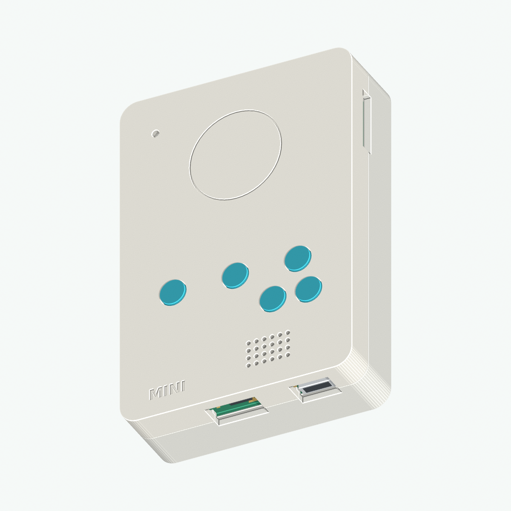
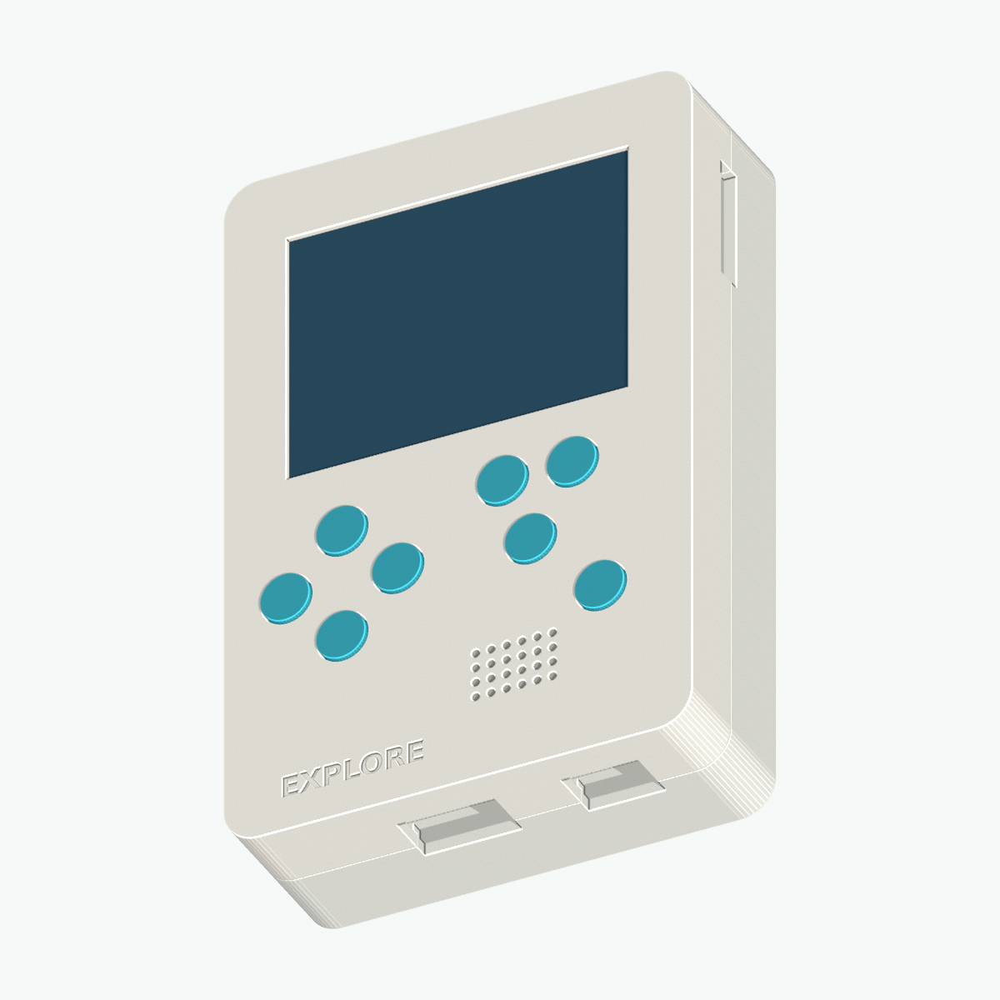

# Open Conteuse — compact custom hardware R1

Engineering prototype dossier, 19 November 2026. Two custom devices share an electronics architecture: **Mini, screenless NFC, 65 ×95 ×22 mm**, and **Explore, 2.4-inch display, 67 ×100 ×24 mm**. The older112 ×210 ×50 mm modular design remains intact. These compact sources are new nominal designs; no unit has been fabricated, printed, powered or physically validated. Fabrication release is **not authorized by these files**.

- [Combined illustrated PDF](Compact-R1-dossier.pdf): design, integration, cuts, cost model and assembly.
- [Interactive view gallery](gallery.html): exterior, open, exploded, PCB and six section views per variant.
- [Search every BOM item](BOM.html), [Mini CSV](../../hardware/compact-r1/mini-BOM.csv), [Explore CSV](../../hardware/compact-r1/explore-BOM.csv).
- [Assembly and bring-up](ASSEMBLY.md), [electrical design](ELECTRICAL.md), [dimensions and fit assumptions](DIMENSIONS.md), [cost scope](COST.md), [verification](VALIDATION.md).
- [Vector schematics](schematics/mini.pdf) / [Explore schematic](schematics/explore.pdf).
- [Native KiCad sources](../../hardware/compact-r1), [OpenSCAD and prototype STLs](../../enclosure/compact-r1).

## Decisions carried into the design

Mini uses a marked tap area with a small ferrite-backed NFC antenna. It no longer encloses a full credit-card-sized card, whose85.6 mm length would consume nearly the entire body. Five captive keys retain previous/play/next/volume interaction. Explore uses eight keys and a raw2.4-inch panel. Its width grows2 mm beyond the earlier65 mm target to leave a nominal 1 mm ribbon-fold radius and side clearance; retaining2.8-inch is a separate wider architecture, not a silently substituted panel.

Both use a native soldered ESP32-S3-WROOM-1-N16R8, protected1200 mAh replaceable pouch, USB-C, microSD, dedicated headphone codec/amp, independent event latch for the speaker, power-path charging and a new integrated main PCB. They have separate component placements/PCB files because the control positions and NFC/display circuitry differ. No large controls board, DevKit headers or45 mm mute daughterboard remains.

The selected documented NFC module costs materially more than the earlier generic NFC allowance. The revised BOM therefore supersedes the previous€34–63 Mini target for this particular design. Prices are planning assumptions, not binding quotes. Bare-reader RF integration could reduce future unit cost but is not presented as completed in this revision.

## How to read the views

Main PCBs are green for Mini and blue for Explore; metal RF shield/connectors are silver, cell amber, NFC board blue, antenna copper, keys teal and shell warm ivory. The native PCB pads/tracks come from KiCad. Shells and keycaps come from exported OpenSCAD solids. Small component bodies, cell, NFC and panel are **nominal physical envelopes** based on library/datasheet dimensions; they are not claimed to be supplier-certified STEP models. Wire/ribbon routes are reserved paths requiring a real assembly trial. Orange section faces show actual clipping planes, not separate parts. Exploded offsets separate the layers for inspection; they do not prove an assembly motion or cable reach.

The guide is a complete digital prototype package, not evidence that the hardware is child-ready. All electrical, thermal, acoustic, RF, drop, battery and print-fit validation remains pending. No purchases, supplier uploads, fabrication orders or Telmi fork were made in this stream.
