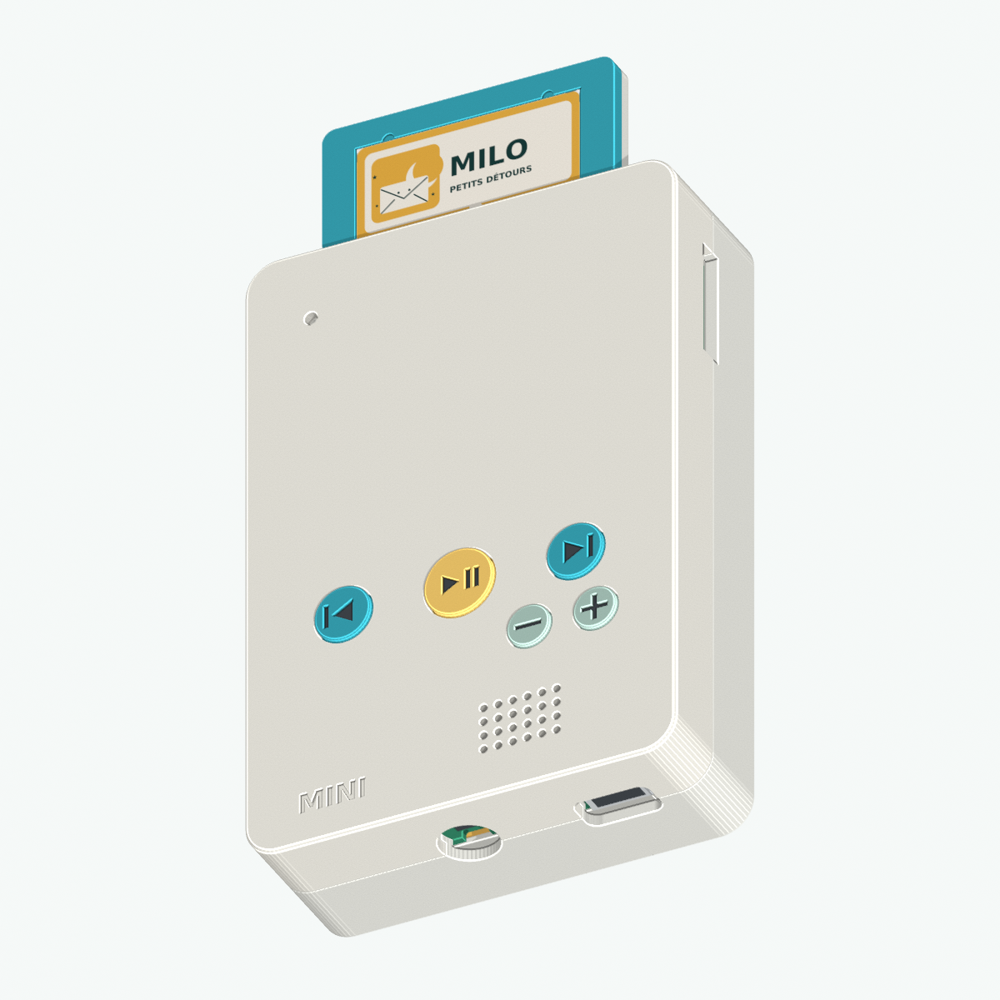
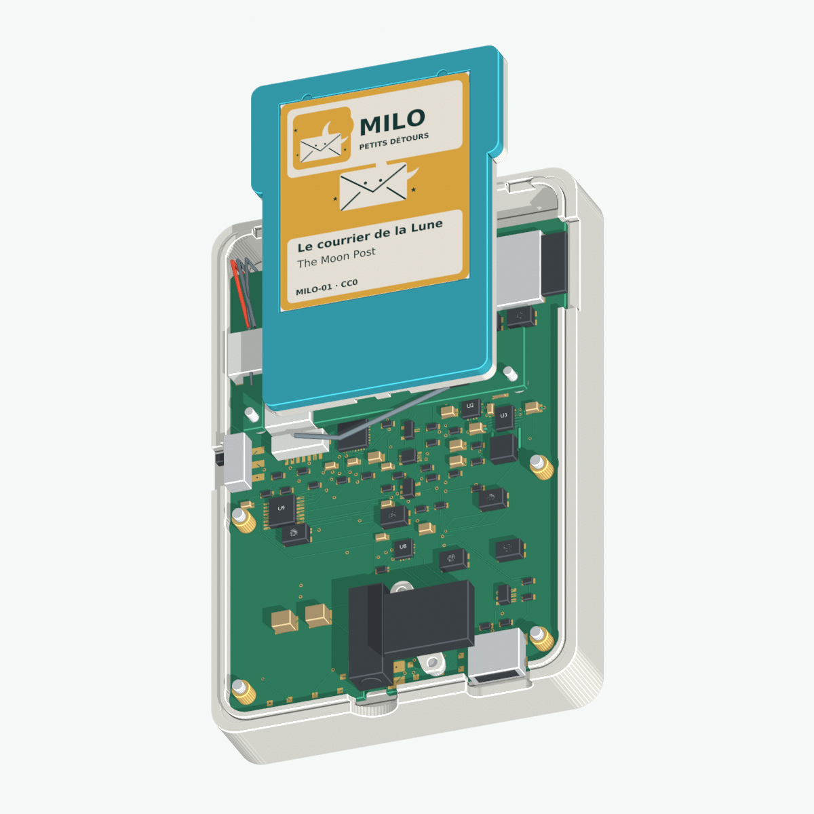
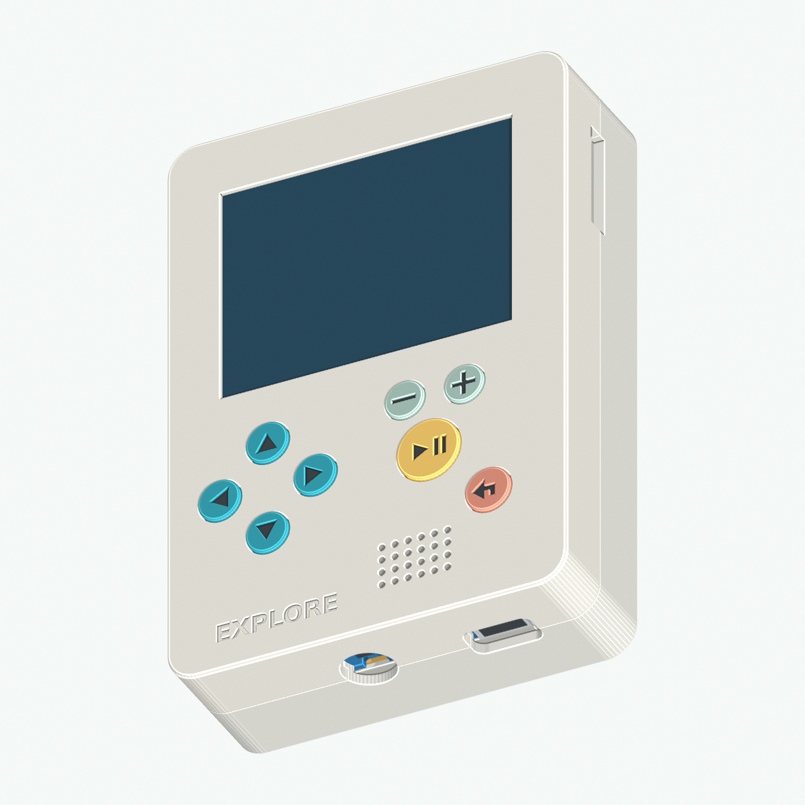
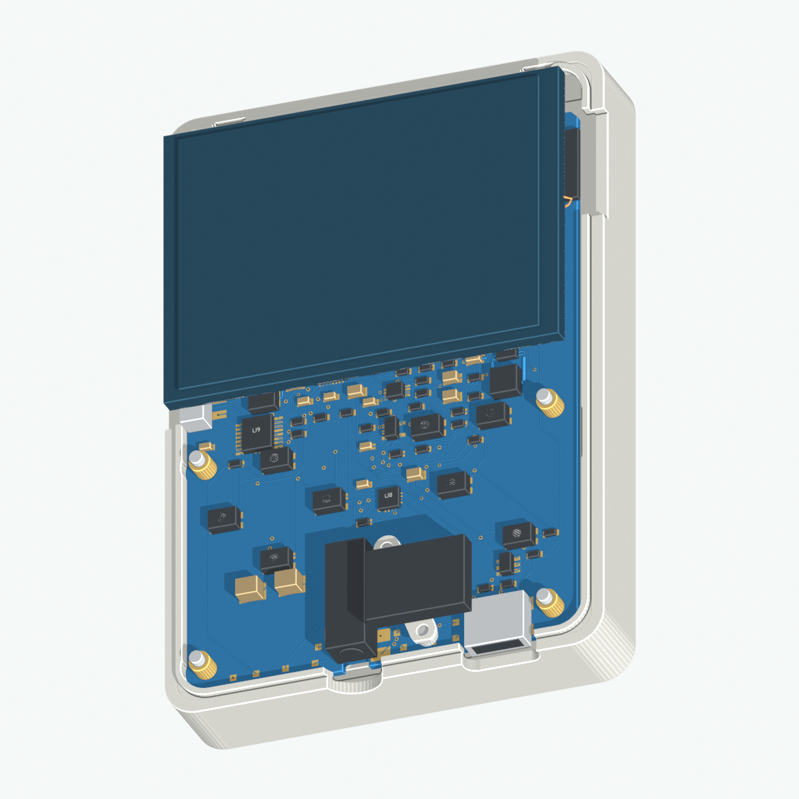

# Current engineering and assembly dossier

20 November 2026 · RFQ reference · physical validation pending. Native designs and meshes are suitable for engineering review and prototype print trials; fabrication/child-use qualification is not complete.

| Item | Mini contact ID | Explore |
|---|---|---|
| Case W×H×D | 65×95×24mm | 67×95×24mm |
| Main PCB | 60×83×1.2mm, 4layers | same outline/stack |
| Selection | Passive serial-ID cartridge | 2.4-inch display/buttons |
| Reader PCB | 50×11×1.6mm, 2layers | none |
| Token PCB | 20×12×0.8mm, 2layers | none |
| Cartridge | 40mm inserted width,60mm length,4.3mm body;44mm handle | none |
| Inserted projection | 20mm; player overallheight115mm | none |
| Ports | USB-C5V charging/data,3.5mm headphones,microSD | same |

Canonical dimensions use the case front-view left/top asXY origin and the rear exterior asZ0, increasing toward the front. Native PCB coordinates subtract the30mm drawing offset; STL exports mirrorY to preserve physical handedness. All dimensions are millimetres.

Dimensions above are case bodies. Caps add0.6mm at the front: overall depth24.6mm. Mini with a seated cartridge is65×115×24.6mm overall; Explore is67×95×24.6mm overall.

The case depth increased to24mm to house the contact mechanism. Dimensions are CAD nominal values, not measured fits. Cartridge is a ROM selector only; all stories remain on player storage. Explore has no card-reader population.

[Product UX contract](UX.md) · [Parent personalization / MCP assessment](../PERSONALIZATION.md)

## Design files and views

Native projects: [Mini](../../hardware/mini/mini.kicad_pro), [Explore](../../hardware/explore/explore.kicad_pro), [reader](../../hardware/card-reader/card-reader.kicad_pro), [token](../../hardware/story-card/story-card.kicad_pro). Each directory contains components.json, BOM.csv, local footprints and actual checks.

[Electrical design and source references](ELECTRICAL.md) · [OpenSCAD enclosure](../../enclosure/design.scad) · [cartridge](../../enclosure/card.scad) · [print meshes](../../enclosure/print/) · [image gallery](images/) · [RFQ and costs](../../rfq/README.md).

Each variant has front/rear/side/top/bottom, open-front/open-rear, exploded, PCB and battery-service views, plus six section views. Boards are green(Mini) and blue(Explore); orange sections identify cut faces. Component bodies are documented nominal envelopes, not supplier-certified STEP models. Harness routing is illustrative and requires actual strain relief and service-loop checks.

[Printable paper cards](../../content/starter/cards.pdf) · [Electronic cartridge artwork labels](../../content/starter/cartridge-labels.pdf):33.6×38.6mm labels, paper+adhesive≤0.15mm assumption, physical fit pending.

## Contact mechanism and dimensional assumptions

Reader PCB topZ14.95mm. Harwin P70-1000045R spring freeheight3.50±0.20mm; drawing working range2.70–3.00mm, normal2.90mm. Selected padplaneZ17.80 gives2.85mm loaded height. Assembly must measure and shim separation2.85±0.08mm; guide vertical play contributes±0.05mm, nominal worst2.72–2.98mm **before elastic deflection and wear**. FR4 reader was thickened to1.6mm to reduce bending. The small remaining travel margin makes stiffness, tolerance and insertion-force measurements mandatory. Nominal CAD does not certify this stack.

Reader spring centresX29.5/35.5,Y35mm. GND wear lane is2mm longer than DQ, making first/breaking last in the allowed orientation. Rear-side asymmetric key, wider handle, endstop and detent locate the cartridge. Lead-in ramps in both contact lanes prevent full rear shell thickness from sweeping over spring tips. The detent bump intentionally deflects laterally by0.35mm during insertion. The rigid-body sweep excludes this compliant bump, not the guide/leaf body; force, recovery and fatigue remain unvalidated. Qualification must cover partial/wrong insertion, pad wear, contamination, shorts and misalignment.

The reader bounding box is50 × 11 mm with a notched left edge and extended mounting ear, not a full rectangle. Its local datum remains case(8.5,29); native edge_polygon defines the actual outline. The notch clearsJ6 and the upper edge clearsJ5. Reader mounts are(8.5,38),(54.5,39), allowing **standard ISO7045-Z M1.6×4 A2 pan-head screws**,3.2 mm diameter / 1.3 mm height reference envelope. The left mount avoids the main-boardR14/C9 bodies; no custom low-profile screw is needed. Confirm actual head dimensions, tapped-polymer engagement and pullout. ReaderJ1 is on the front at local(35,9), with an0.8mm nominal solder-wire envelope below the guide; no wire ends may protrude under the PCB.

Cartridge screws are ISO7045-Z M1.6×3, heads outside the handle, no metal over the antenna region. Small screws and exposed PCB are adult assembly items; finished token retention and small-parts qualification remain pending. Paper cards in the listening collection are artwork only.

## Prototype print and assembly guide

1. Print coupon first; measure actuator, insert pilot and screw pilots with actual parts. Use unpainted PETG dimensional prototypes. Front print is `print_front.stl`, back is `back.stl`; buttons/bridge are already oriented. Cartridge uses `story-card/print_front.stl` and `back.stl`. Canonical `front.stl` is an assembly reference. Check slicer orientation, support and first-layer compensation; no shrink profile is validated.
2. Inspect machine-assembled PCBs under magnification. Verify native BOM/polarity/pin1, pad bridges, via-in-pad process, isolated rail resistance and solder quality. Never hand-place QFN/codec parts as a consumer assembly step.
3. With cell disconnected, power through a current-limited5V bench source. Verify USB current mode,3V2/1V8, charger states, regulator ripple/load steps and heating. Flash muted diagnostics only; confirm5 Mini / 8 Explore controls and SD/nativeUSB/PSRAM and display or CRC-valid card IDs.
4. Heat-set four M2 inserts using a coupon-qualified process. Fit insulated protected pouch with bonded103AT-2 NTC; retain with a soft band, avoiding compression/puncture. Verify battery connector polarity independently; connector gender is not a polarity guarantee. Check thermistor open/short fault response before battery charging.
5. Fit speaker/gasket and bridge with two M1.6×4 keeper screws. Route harnesses outside screw/pinch/antenna/button/FPC paths. Mini harness: mainJ7 positions1=3V2,2=GND,6=GPIO8 to readerJ1 pads 1/2/3; leave otherpositions empty. Verify continuity before mating.
6. Fit reader with the specified standard M1.6×4 screws. Measure loaded tip-to-pad separation, reader deflection and insertion force; shim only with an agreed insulating drawing. Confirm no spring ever exceeds its minimum loaded height or maximum working height during a full stroke. Fail the build if stack cannot meet the supplier range.
7. Fit DS2401 token PCB on locating pegs, bare wear pads facing springs; install front cover and two M1.6×3 screws. Test ROM family/CRC repeatedly during slow/fast insertion and withdrawal. Attach original artwork only after fit/wear checks; do not cover contacts/key/stop.
8. Explore: verify received LCD FPC contact face/pin1, fit supported panel/lens and protected fold. Never bend at solder termination or clamp glass. Current boost layout needs DFM review before ordering.
9. Close with four M2×14 screws. Check enclosure seam/ports/button travel, strain relief, screw-tip clearance and protected-cell freedom. Finish/paint must be masked off fits; coating thickness requires new coupons. Reopen and inspect after insertion/drop/thermal trials.
10. Audio remains muted until codec driver, headphone insertion event/latch, fail-silent I2C behaviour and acoustic limits are measured. Record every serial number, board/CAD revision and actual measurements in the acceptance report. No unattended charging or child use is authorized by CAD/build results.

## Cost and release boundaries

Mini one-off reference recurring allowance€78.01–173.52 including one cartridge; Explore€71.91–162.06. Add€100–250 setup reserve; engineering, finishing/manual assembly, shipping/tax, conformity and narration are excluded. A token reference material allowance is€5.23–11.30, not a bulk quote. Retail goals€99/129TTC require new volume quotes and a viable margin model; neither is an offered sale price.

[RFQ](../../rfq/README.md) requests a supplier-engineered prototype and written cost breakdown, including unresolved gates. Physical fit, electrical/audio/RF/thermal/battery safety and conformity remain pending. No parts or fabrication ordered.

## Controls and proposed front marking

Mini SW1(15,60)=LEFT/previous, SW2(32.5,60)=A/play-pause, SW3(50,60)=RIGHT/next, SW4(43,70)=VOL_DOWN, SW5(53,70)=VOL_UP. Explore SW1(17,57)=UP, SW2(44,66)=A, SW3(17,73)=DOWN, SW4(9,65)=LEFT, SW5(25,65)=RIGHT, SW6(54,76)=B/back, SW7(40,56)=VOL_DOWN, SW8(50,56)=VOL_UP. XY coordinates are case-front datum. Proposed playback meanings are a firmware target; diagnostics only report active-low inputs.

The source-generated `enclosure/<variant>-marking.svg` defines a proposed2D front-marking guide, not an engraving already present in the STL. Supplier must qualify contrast/ink/adhesion/wear and registration against actual buttons and finish; never put conductive metallic decoration over the antenna.

For one of each player, including one Mini cartridge, the combined recurring reference allowance is€149.92–335.58, or€249.92–585.58 with one shared€100–250setup reserve. Engineering, manual finishing/boxbuild, shipping/tax, extra RFQ cards and spare assemblies remain additional and unquoted. This is not a delivered prototype quote. Personalization/MCP/TTS integrations and any third-party subscription/API charges remain additional and unassessed.

## Rebuilding the engineering artifacts

Native sources are authoritative. Toolchain used: KiCad9.0.2 with its Python pcbnew, OpenSCAD2021.01, Blender4.3.2, DejaVu fonts; Python artifact dependencies are pinned in scripts/requirements-artifacts.txt. These are build tools, not hosted product services. Upstream tool licences remain applicable.

After an intentional source change: export mechanical/copper data with `/usr/bin/python3 scripts/export_mechanical.py` and `export_copper.py`; run `sh scripts/cad-check.sh`; prepare exact label textures with `python3 scripts/prepare_render_assets.py`; render with `blender -b --python scripts/render_design.py`; export quote references with `python3 scripts/export_manufacturing_reference.py`; build the PDF/gallery/BOM with `python3 scripts/build_dossier.py`; package with `python3 scripts/package_rfq.py`; run `sh scripts/check.sh`; assemble the static site with `python3 scripts/build_site.py`. Regenerate receipts rather than relabelling old images. Set writable XDG config/cache/data paths as in cad-check.sh.

The Explore case was shortened from the earlier exploration envelope to95mm high because its native PCB already shares the Mini board outline. This removes5mm of unnecessary lower-case recess without moving the LCD or switch centres. Both current variants are95mm high; only current meshes are shipped.
