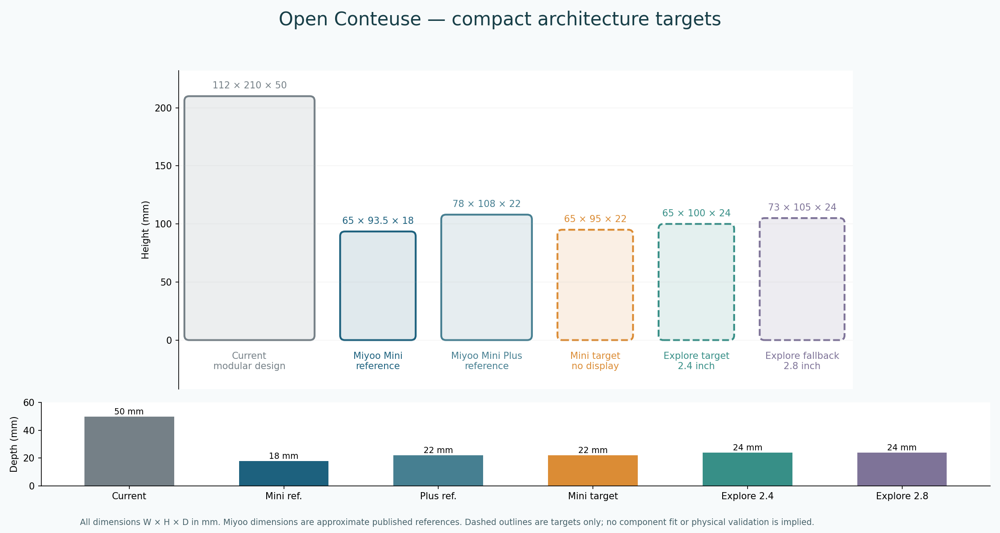

# Compact hardware and cost reduction assessment

Updated 18 November 2026. The existing design is **112 mm wide × 210 mm tall × 50 mm thick**, for both Mini and Explore. Its rectangular bounding volume is 1176 cm³. It is a modular integration prototype, not an appropriate final architecture for a Miyoo Mini sized product.

My recommendation is to keep two tracks: **a custom compact PCB for the screenless NFC Mini**, and **Telmi on a Wi-Fi-equipped console as the fastest inexpensive Explore software prototype**. Do not pay to fabricate another large breakout-board carrier before resolving the compact architecture.

## Size targets

All dimensions below are width × height × depth. Miyoo figures are commonly advertised reference dimensions, not measured drawings for enclosure design. Our new dimensions are **targets**, not demonstrated fits.

| Design | Envelope, mm | Bounding volume | Change from first design |
| --- | --- | ---: | ---: |
| Existing modular Mini / Explore |112 × 210 × 50|1176 cm³|baseline|
| Original Miyoo Mini reference |65 × 93.5 × 18|109.39 cm³|90.70% smaller|
| Miyoo Mini Plus reference |78 × 108 × 22|185.33 cm³|84.24% smaller|
| Custom screenless Mini target |65 × 95 × 22|135.85 cm³|88.45% smaller|
| Custom Explore target,2.4inch |65 × 100 × 24|156 cm³|86.73% smaller|
| Explore2.8inch fallback target |73 × 105 × 24|183.96 cm³|84.36% smaller|

The first design is about 10.75 times the original Mini's bounding volume. The 22–24 mm depth targets allow more development margin than copying 18 mm immediately. They still need full component, connector, battery and tolerance stack validation. Reference dimensions: [Mini comparison reference](https://www.kibotek.com/en/kibonews/new-miyoo-mini-portable-retro-console/), [Mini/Plus comparison reference](https://www.kibotek.com/fr/kibonews/miyoo-mini-plus-maintenant-disponible-en-pre-achat-chez-kibotek/). These are retailers’ own advertised comparison envelopes, not manufacturer mechanical drawings; no internal Miyoo board geometry is inferred from them.

## What must change

| First-design driver | Compact direction | Consequence |
| --- | --- | --- |
|120 × 50mm PN532 breakout |Small reader circuit and tuned PCB/flex antenna |Cannot reuse the current reader PCB or its mounts; RF matching, metal/battery clearance and read range need testing|
|Full front card holder |Tap area or partial insertion guide |An85.6 × 54mm card plus a separate button area does not fit inside a95mm-long body; a protruding card also increases the in-use envelope|
|DevKit with headers |ESP32-S3 module directly soldered to main PCB |Removes devboard/connectors/header height; adds reset/boot, USB, power and RF design work|
|Separate controls/latch/audio/power/SD boards |One custom main PCB, SMD logic and direct microSD socket |Eliminates daughterboard mounting stacks, harnesses and many fasteners; requires assembled-board bring-up and test access|
|70 × 30 × 19.7mm speaker enclosure |Thin miniature speaker with a designed acoustic chamber |Lower acoustic volume/output and different bass response; sound limits and intelligibility must be measured|
|2500mAh cell envelope |Exact smaller protected cell, initially about1000–1500mAh as a capacity target |Runtime may decrease; no runtime guarantee follows from capacity alone|
|Large LCD breakout and touch glass |Raw LCD/FPC, omit unused touch |Different display module/driver and mechanical integration; exact panel not frozen|

**Do not scale the old STL.** That scales screw holes, wall thickness and connector apertures without shrinking the purchased modules.

## Main PCB direction

Reserve approximately60 × 89mm for Mini and60 × 94mm for Explore, within a65mm-wide case with1.8mm nominal walls. These are board-area budgets, not completed layouts. A four-layer board is the preferred layout study because RF, codec analogue grounding and switching power share a small area; a two-layer cost option needs explicit routing/EMI review.

Use the **ESP32-S3-WROOM-1-N16R8 module**, rather than the DevKit, as the conservative MCU starting point: its18 × 25.5 × 3.1mm body preserves the16MB flash/8MB PSRAM class. Preserve USB/boot/OPI pin reservations and the RF antenna keepout. The smaller **ESP32-S3-MINI-1** family is not a drop-in N16R8 equivalent: the documented N8 variant lacks PSRAM, while N4R2 has4MB flash/2MB PSRAM and would require memory/partition validation. [WROOM datasheet](https://www.espressif.com/sites/default/files/documentation/esp32-s3-wroom-1_wroom-1u_datasheet_en.pdf), [MINI datasheet](https://documentation.espressif.com/esp32-s3-mini-1_mini-1u_datasheet_en.html).

Retain a real headphone drive path, charge power path, stable3.3V supply, battery protection and independent fail-muted behaviour. Their functions are not optional cost savings. A low-cost charger alone is not a power-path controller. Reset, current-limit, brownout, headphone insertion and boot sequencing remain design/measurement gates.

The **TLV320DAC3100 already integrates headphone and mono class-D outputs** in a5 × 5mm IC. This is a legitimate consolidation candidate, but not an automatic deletion of the MAX98357A from the current design. Its rail constraints, speaker control and independent insertion-mute behaviour must be proved first. Retaining a separate small SMD speaker amplifier with a hardware shutdown pin is a reasonable first compact revision. The Adafruit6309 board documentation calls for5V for its speaker configuration; it does not justify using that output unchanged on the current3V3 wiring. [TI device documentation](https://www.ti.com/product/TLV320DAC3100), [Adafruit board documentation](https://www.adafruit.com/product/6309).

NFC should be a separately costed Mini function. Compare a small PN532-based first prototype with a current integrated NCI reader for the final PCB, but freeze neither without antenna/reference-design and driver work. The old long reader board is excluded from both compact targets. Explore remains without NFC in these estimates.

## Display decision

The current2090 glass is about50 × 69mm in its native portrait orientation. Rotated to a landscape handheld, its69mm width already exceeds the65mm exterior target before walls. A2.8inch diagonal alone does not establish fit: the raw panel outline, bezel, FPC tail/bend radius and driver interface decide it.

A manufacturer-listed2.4inch raw panel family, e.g. RONBO **RB024D18N01B1**, advertises42.72 × 60.26 × 2.3mm and ILI9341V. Rotated landscape, its60.26mm width leaves only1.14mm total inside a61.4mm cavity; this is a tight outline feasibility check, not a full FPC or tolerance fit. This source's thousand-unit pricing must not be used as a single-prototype price. [Manufacturer panel page](https://www.ronboe.com/shop/rb024d18n01b1/).

Propose2.4inch for the65mm-wide Explore study, explicitly changing the original approximately2.8inch brief. If2.8inch must remain, study a73mm-wide body and a suitable raw panel instead. Do not freeze that fallback envelope until a precise panel drawing is selected.

## Already integrated development boards

| Candidate | Useful integration | Why it is not selected as the final compact board |
| --- | --- | --- |
|Espressif ESP32-LyraT-Mini V1.2 |Audio, microSD, battery charging, keys and3.5mm headphone output |Official drawing is72 × 77mm: too wide for the65mm body. Older ESP32, Micro-USB, mono audio and software-selected speaker/headphone path. Useful architecture reference, not a drop-in S3 target|
|Waveshare ESP32-S3-AUDIO-Board |S3R8/16MB flash, codec, TF, charging, USB-C, LCD interface |Worth a compact prototype screen, but exact outline/height and jack/mute, pin sharing and power-path behaviour must be checked. The published feature list does not establish a complete headphone/NFC handheld|
|Screen development boards such as ESP32-S3-Touch-LCD-2 |Display, MCU and charging already on one PCB |The2inch display changes the brief; documented MCU/display/charger integration does not by itself supply the required headphone/audio path, controls and NFC|
|Miyoo Mini Plus + Telmi |Finished display, battery, controls, speaker, headphone socket, housing and Wi-Fi platform |Fastest low-volume software route, but larger than original Mini and not a screenless NFC device; see the separate Telmi assessment|

Primary references: [LyraT-Mini features](https://docs.espressif.com/projects/esp-adf/en/latest/multimedia-boards/dev-boards/get-started-esp32-lyrat-mini.html), [LyraT-Mini mechanical drawing](https://dl.espressif.com/dl/schematics/Layout_ESP32-LyraT-Mini_V1.2_20220317.pdf), [LyraT-Mini output-selection reference](https://docs.espressif.com/projects/esp-adf/en/latest/multimedia-boards/dev-boards/board-esp32-lyrat-mini-v1.2.html), [Waveshare audio board](https://docs.waveshare.com/ESP32-S3-AUDIO-Board), [Waveshare2inch board](https://docs.waveshare.com/ESP32-S3-Touch-LCD-2).

## Cost targets and one-off economics

The line-item model in [assessment.json](../../hardware/compact/assessment.json) deliberately separates **engineering targets** from observed offers. It includes a protected cell, SD card, speaker, case and assembly allowance, not only the MCU board. Its arithmetic gives:

| Quantity assumption | Mini recurring target | Explore2.4inch recurring target |
| --- | ---: | ---: |
|5 assembled units |€41–78 each|€43–81 each|
|25 assembled units |€34–63 each|€36–66 each|

These are not quotes and exclude VAT, delivery, engineering labour, tools, certification and extra PCB spins. Reserve another€100–250 per first batch for setup/rework/spares as a planning assumption. Five Mini units therefore budget€305–640 before those exclusions. Do not compare€34 recurring material/assembly at25 units to the previous€285–355 first-purchase Mini cash budget as if both were the same quantity and scope.

For a much cheaper immediate prototype, a checked **Miyoo Mini Plus seller listing displayed US$59.99** for its default Black/64GB selection on 18 November 2026. That is a seller observation, not an authenticated supply-chain endorsement or landed quote; no-card/clean-card configuration, stock, destination tax and delivery must be checked. Original Mini V4 was displayed at the same price but marked sold out. No bundled game/audio content is required or included in our work. [Plus listing](https://lomiyoo.com/products/miyoo-mini-plus), [Mini V4 listing](https://lomiyoo.com/products/miyoo-mini-v4).

## Next concrete milestones

1. Keep the existing large design as a source/validation reference, not the next fabrication candidate.
2. Freeze the compact Mini interaction: tap versus partial slot, exact cell/speaker, and headphone hardware-mute architecture. Then do true layered placement including antenna and plug/wire keepouts.
3. Freeze Explore's2.4inch versus2.8inch raw panel. Only then produce the compact schematic/PCB, new pin allocation, fitted enclosure and print release.
4. In parallel, validate approved-content export to stock Telmi on an exact Wi-Fi-capable console. Use that for software feedback while custom hardware proceeds.

The [SCAD envelope study](../../enclosure/compact-study/targets.scad) and size plot are comparison artefacts only. They contain no fitted mounts, electrical design or print-ready shell. All physical validation is pending. No purchases or fabrication orders were made.
