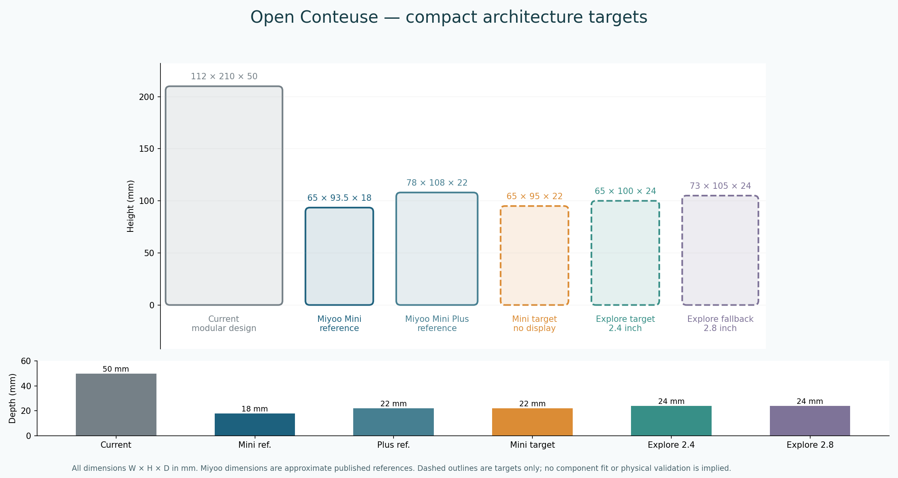

# Compact hardware and Telmi assessment

Two independent product directions follow the first modular prototype:

- [Compact custom hardware](COMPACT_HARDWARE.md): current dimensions, Miyoo-sized targets, integrated-board options, quantity-dependent cost targets and the next mechanical/electrical decisions.
- [Telmi console software](TELMI_ASSESSMENT.md): pinned upstream feature assessment, existing podcast RSS support, original-spec gaps, thin-fork strategy and actual build evidence.

The [target/cost data](../../hardware/compact/assessment.json), [computed arithmetic](../../hardware/compact/summary.json), [build verification](../../hardware/compact/verification.json) and [SCAD envelope study](../../enclosure/compact-study) are reviewable sources. They do not replace the previous detailed CAD baseline or establish a compact physical fit. No purchases or fabrication orders were made.
