# Open Conteuse Mini and Explore visual design atlas

Updated 18 November 2026. Mini and Explore share a nominal 112 × 210 × 50 mm enclosure. Mini has an NFC card area and five buttons. Explore has an unpowered display and eight buttons; this revision omits Explore NFC. The assembly is a digital prototype with physical fit still pending. Shared module close-ups are grouped with Mini; Explore adds its display and eight-switch board.

[Download the complete PDF](Open-Conteuse-Visual-Atlas.pdf)

The document contains 72 shaded CAD figures and 44 PDF pages. Each section is a separate view of the actual nominal assembly geometry.

## Colours and model confidence

Blue: Adafruit PCBs. Green: proposed custom PCB soldermask. Black: chips, sockets and speaker enclosure. Silver: connector shells, shield and cell foil. Gold: contacts. Warm white: proposed case finish. Grey: removable carrier and retainers. Teal/amber: proposed button finishes. Orange: section faces, not the material colour.

Nine manufacturer STEP assemblies supply purchased-module geometry. Native KiCad supplies the custom PCB outlines, holes, pads, tracks and silkscreen; their component bodies are generic illustrations at native footprint positions. MCU and regulator details are visual proxies within reserved envelopes. Colours and added identification labels are illustrative, not exact manufacturer artwork. Optional tall breakout headers, screw-terminal block, wires and fasteners are omitted. No wiring or fastening is implied by an empty space. Purchased-module models may be single external solids: section caps do not reveal speaker, cell or other hidden internal construction.

Pending: received MCU/header height and switch actuator measurements; printer-specific slicing/support and physical fit; integrated codec/latch firmware; electrical, charging, acoustic, thermal, runtime and drop/retention tests. Rendering is not evidence of those properties. No purchases or fabrication orders were made.

## Coordinate guide

X: across 112 mm width. Y: USB end 0 → controls end 210 mm. Z: front 0 → rear 50 mm. Orange indicates section faces. Cuts A/B/C: X 32/56/82 mm; D/E/F: Y 20/95/168 mm; G/H: Z 15/35 mm. Lower/higher retained side is stated in every section caption.

## Mini views

### Exterior 01

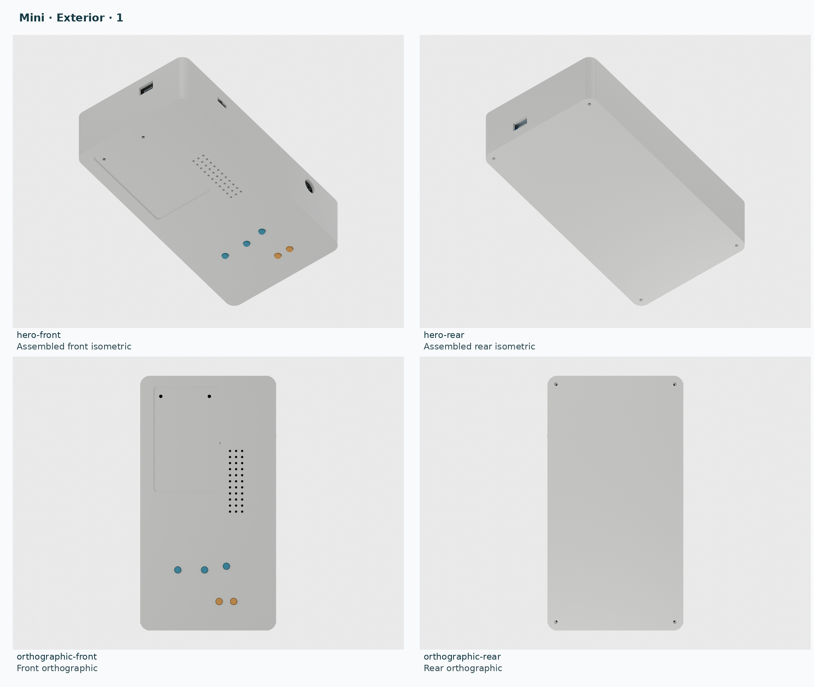

### Exterior 02

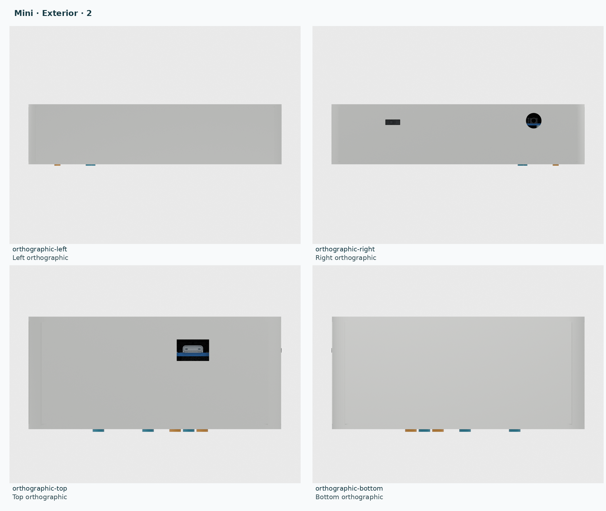

### Assembly 01

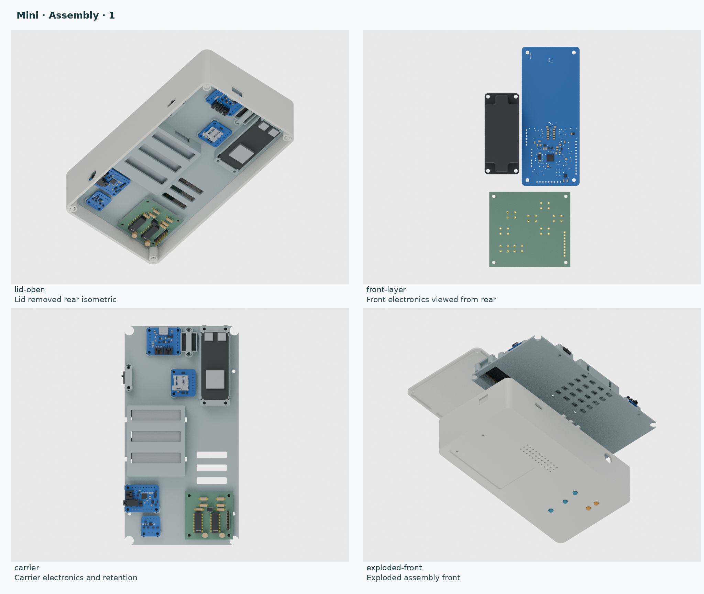

### Assembly 02

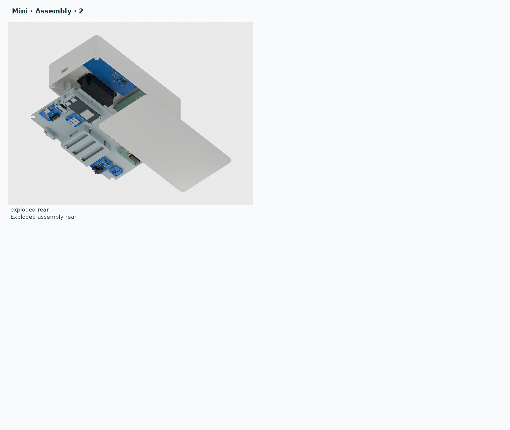

### Sections 01

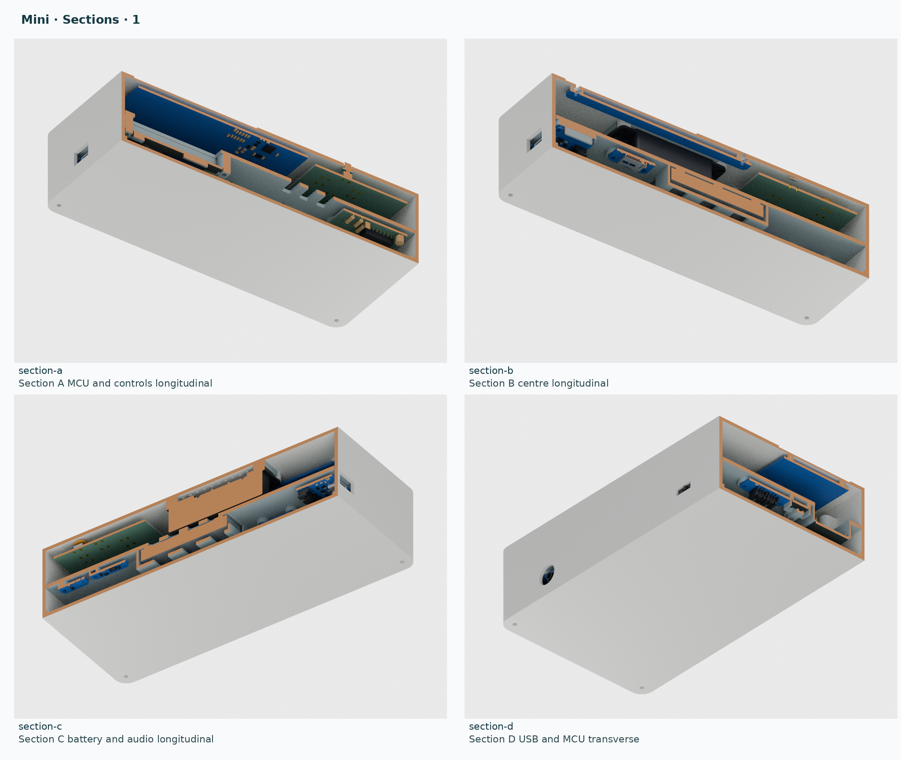

### Sections 02

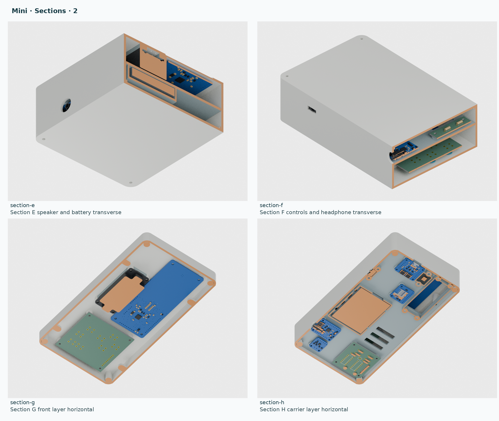

### Details 01

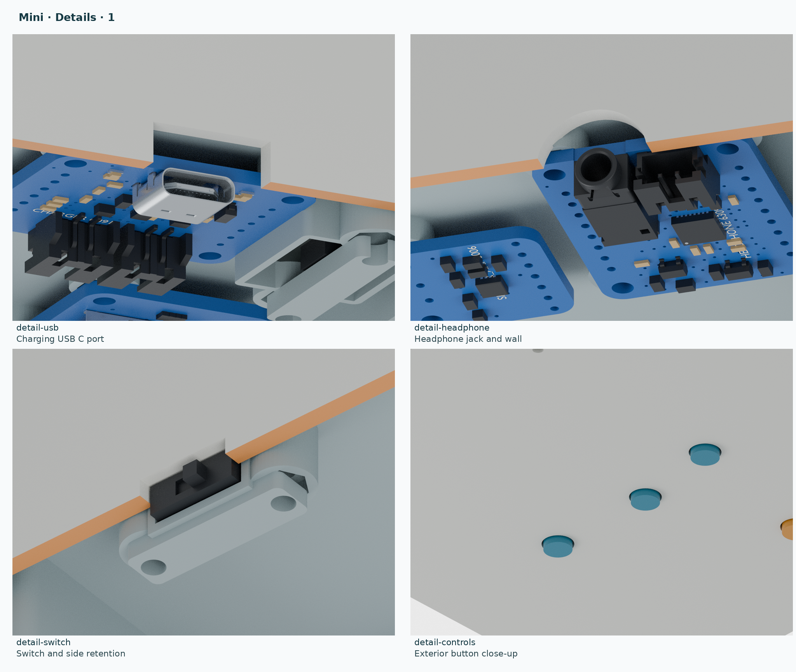

### Details 02

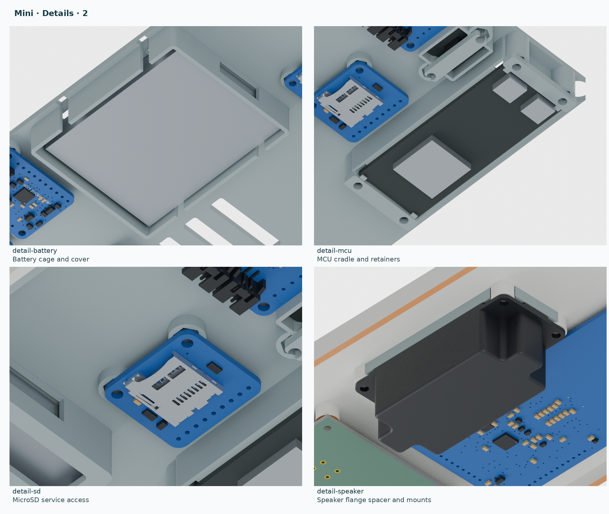

### Boards 01

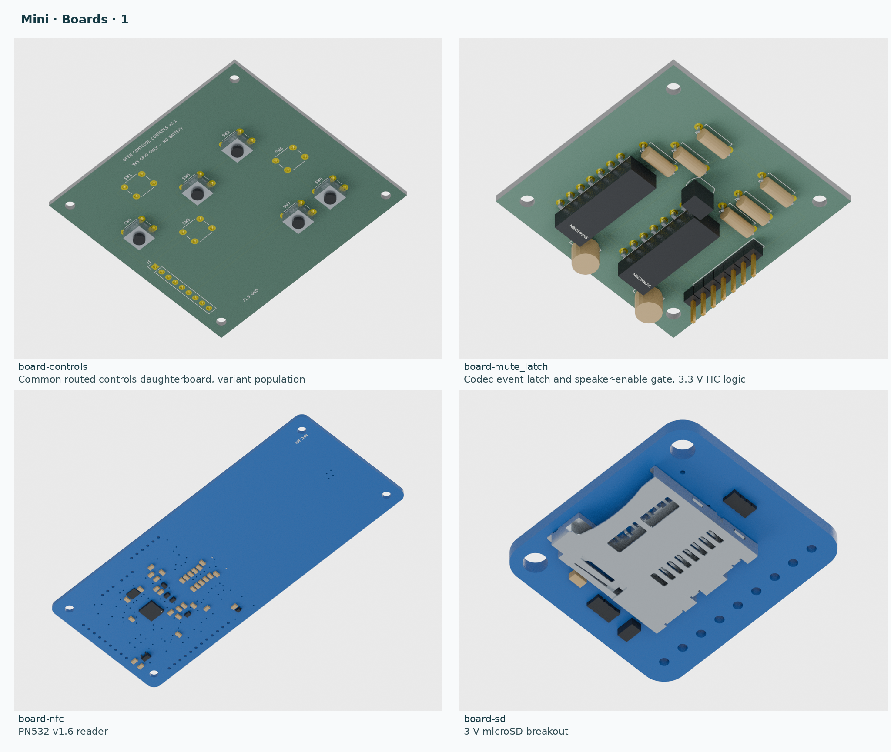

### Boards 02

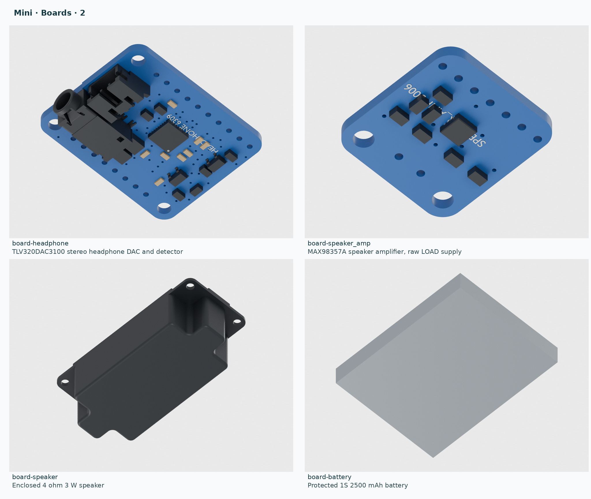

### Boards 03

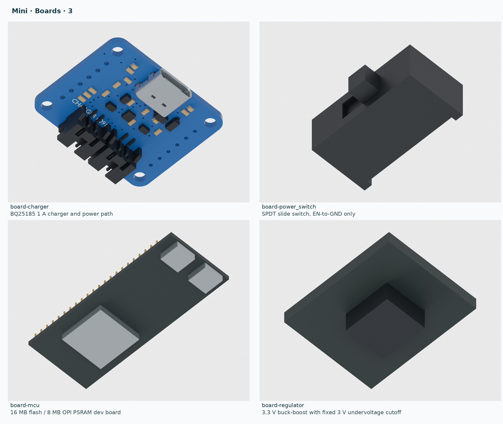

### Full resolution figure index

| View | Description | Interpretation |
| --- | --- | --- |
| [hero-front](images/mini-hero-front.png) | Assembled front isometric | Full nominal assembly. Mini has no display; case and button colours are proposed finishes. |
| [hero-rear](images/mini-hero-rear.png) | Assembled rear isometric | Full nominal assembly. Mini has no display; case and button colours are proposed finishes. |
| [orthographic-front](images/mini-orthographic-front.png) | Front orthographic | Full nominal assembly. Mini has no display; case and button colours are proposed finishes. |
| [orthographic-rear](images/mini-orthographic-rear.png) | Rear orthographic | Full nominal assembly. Mini has no display; case and button colours are proposed finishes. |
| [orthographic-left](images/mini-orthographic-left.png) | Left orthographic | Full nominal assembly. Mini has no display; case and button colours are proposed finishes. |
| [orthographic-right](images/mini-orthographic-right.png) | Right orthographic | Full nominal assembly. Mini has no display; case and button colours are proposed finishes. |
| [orthographic-top](images/mini-orthographic-top.png) | Top orthographic | Full nominal assembly. Mini has no display; case and button colours are proposed finishes. |
| [orthographic-bottom](images/mini-orthographic-bottom.png) | Bottom orthographic | Full nominal assembly. Mini has no display; case and button colours are proposed finishes. |
| [lid-open](images/mini-lid-open.png) | Lid removed rear isometric | Lid hidden; front shell and removable carrier remain assembled. Harness and screws omitted. |
| [front-layer](images/mini-front-layer.png) | Front electronics viewed from rear | Case and rear carrier hidden; view faces the rear of the controls PCB. The controls detail shows the opposite actuator side. |
| [carrier](images/mini-carrier.png) | Carrier electronics and retention | Front shell and front electronics hidden. Rear module placement, battery cover and retainers are visible; MCU/regulator are visual proxies. |
| [exploded-front](images/mini-exploded-front.png) | Exploded assembly front | Display offsets only: rear layer +45 mm X/+60 mm Z; lid −80 mm X/+35 mm Y/+120 mm Z. These are not removal paths or measured clearances. |
| [exploded-rear](images/mini-exploded-rear.png) | Exploded assembly rear | Display offsets only: rear layer +45 mm X/+60 mm Z; lid −80 mm X/+35 mm Y/+120 mm Z. These are not removal paths or measured clearances. |
| [section-a](images/mini-section-a.png) | Section A MCU and controls longitudinal | Plane X = 32 mm; retain higher coordinates. Orange marks solid cut faces; voids stay open. Native copper/silk surfaces are clipped without solid caps. Generic/proxy components remain illustrative; supplied module solids do not resolve hidden internal construction. |
| [section-b](images/mini-section-b.png) | Section B centre longitudinal | Plane X = 56 mm; retain higher coordinates. Orange marks solid cut faces; voids stay open. Native copper/silk surfaces are clipped without solid caps. Generic/proxy components remain illustrative; supplied module solids do not resolve hidden internal construction. |
| [section-c](images/mini-section-c.png) | Section C battery and audio longitudinal | Plane X = 82 mm; retain lower coordinates. Orange marks solid cut faces; voids stay open. Native copper/silk surfaces are clipped without solid caps. Generic/proxy components remain illustrative; supplied module solids do not resolve hidden internal construction. |
| [section-d](images/mini-section-d.png) | Section D USB and MCU transverse | Plane Y = 20 mm; retain higher coordinates. Orange marks solid cut faces; voids stay open. Native copper/silk surfaces are clipped without solid caps. Generic/proxy components remain illustrative; supplied module solids do not resolve hidden internal construction. |
| [section-e](images/mini-section-e.png) | Section E speaker and battery transverse | Plane Y = 95 mm; retain higher coordinates. Orange marks solid cut faces; voids stay open. Native copper/silk surfaces are clipped without solid caps. Generic/proxy components remain illustrative; supplied module solids do not resolve hidden internal construction. |
| [section-f](images/mini-section-f.png) | Section F controls and headphone transverse | Plane Y = 168 mm; retain lower coordinates. Orange marks solid cut faces; voids stay open. Native copper/silk surfaces are clipped without solid caps. Generic/proxy components remain illustrative; supplied module solids do not resolve hidden internal construction. |
| [section-g](images/mini-section-g.png) | Section G front layer horizontal | Plane Z = 15 mm; retain lower coordinates. Orange marks solid cut faces; voids stay open. Native copper/silk surfaces are clipped without solid caps. Generic/proxy components remain illustrative; supplied module solids do not resolve hidden internal construction. |
| [section-h](images/mini-section-h.png) | Section H carrier layer horizontal | Plane Z = 35 mm; retain lower coordinates. Orange marks solid cut faces; voids stay open. Native copper/silk surfaces are clipped without solid caps. Generic/proxy components remain illustrative; supplied module solids do not resolve hidden internal construction. |
| [detail-usb](images/mini-detail-usb.png) | Charging USB C port | Charge-only USB C opening. Upper housing is cut away at Z35 to reveal the socket; service USB power isolation is still required. |
| [detail-headphone](images/mini-detail-headphone.png) | Headphone jack and wall | Jack mouth and recess. Upper housing cut away at Z35; plug-barrel fit and insertion-mute validation pending. |
| [detail-switch](images/mini-detail-switch.png) | Switch and side retention | Conservative switch body envelope and retainer. Upper housing cut away at Z35. Actuator dimensions still require received-part measurement. |
| [detail-controls](images/mini-detail-controls.png) | Exterior button close-up | Exterior button caps against the opaque front face; the internal switch stack is not visible here. See section A and the controls PCB view for the internal parts. The documented nominal cap-to-switch gap is 0.2 mm. |
| [detail-battery](images/mini-detail-battery.png) | Battery cage and cover | Battery cover hidden. Rigid cage carries tie tension; do not compress the pouch cell. Cell is shown by manufacturer body geometry; tie/wire routing omitted. |
| [detail-mcu](images/mini-detail-mcu.png) | MCU cradle and retainers | Cradle, edge seats and retaining fingers. MCU geometry is illustrative; assembled/header height remains a fit gate. |
| [detail-sd](images/mini-detail-sd.png) | MicroSD service access | Rotated microSD breakout and removal region. Card extraction is toward +X; reserve the layout corridor and keep the harness out. No removable card is inserted in this render. |
| [detail-speaker](images/mini-detail-speaker.png) | Speaker flange spacer and mounts | Rear layer hidden; housing removed above Z8 to expose flange supports and spacer. Local flange bearing Z 1.0–2.7 mm; post top global Z 7.4 mm; rigid spacer 4 mm. No acoustic seal validated. |
| [board-controls](images/mini-board-controls.png) | Common routed controls daughterboard, variant population | Open Conteuse CONTROLS-V0.1. Native KiCad board with generic component bodies; green soldermask is proposed. |
| [board-mute_latch](images/mini-board-mute_latch.png) | Codec event latch and speaker-enable gate, 3.3 V HC logic | Open Conteuse MUTE-LATCH-V1. Native KiCad board with generic component bodies; green soldermask is proposed. |
| [board-nfc](images/mini-board-nfc.png) | PN532 v1.6 reader | Adafruit 364. Manufacturer CAD geometry with illustrative finish and component material assignment. |
| [board-sd](images/mini-board-sd.png) | 3 V microSD breakout | Adafruit 4682. Manufacturer CAD geometry with illustrative finish and component material assignment. |
| [board-headphone](images/mini-board-headphone.png) | TLV320DAC3100 stereo headphone DAC and detector | Adafruit 6309. Manufacturer CAD geometry with illustrative finish and component material assignment. |
| [board-speaker_amp](images/mini-board-speaker_amp.png) | MAX98357A speaker amplifier, raw LOAD supply | Adafruit 3006. Manufacturer CAD geometry with illustrative finish and component material assignment. |
| [board-speaker](images/mini-board-speaker.png) | Enclosed 4 ohm 3 W speaker | Adafruit 3351. Manufacturer CAD geometry with illustrative finish and component material assignment. |
| [board-battery](images/mini-board-battery.png) | Protected 1S 2500 mAh battery | Adafruit 328. Manufacturer CAD geometry with illustrative finish and component material assignment. |
| [board-charger](images/mini-board-charger.png) | BQ25185 1 A charger and power path | Adafruit 6091. Manufacturer CAD geometry with illustrative finish and component material assignment. |
| [board-power_switch](images/mini-board-power_switch.png) | SPDT slide switch, EN-to-GND only | Adafruit 805. Manufacturer CAD geometry with illustrative finish and component material assignment. |
| [board-mcu](images/mini-board-mcu.png) | 16 MB flash / 8 MB OPI PSRAM dev board | Espressif ESP32-S3-DevKitC-1-N16R8. Visual proxy; not a manufacturer-verified assembled model. |
| [board-regulator](images/mini-board-regulator.png) | 3.3 V buck-boost with fixed 3 V undervoltage cutoff | Pololu S9V11F3S5C3. Visual proxy; not a manufacturer-verified assembled model. |

## Explore views

### Exterior 01

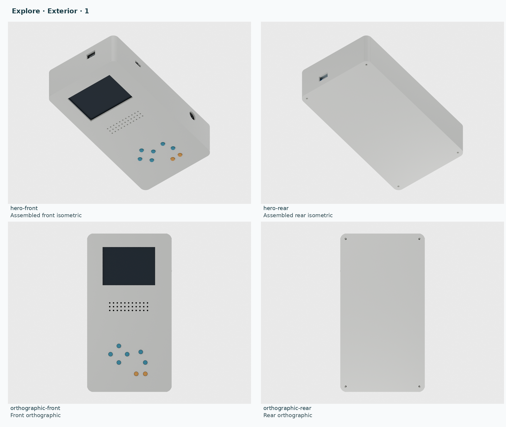

### Exterior 02

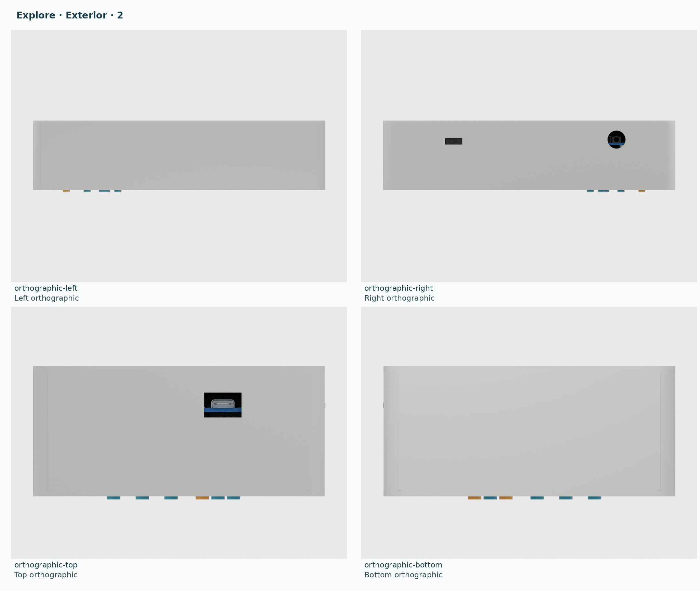

### Assembly 01

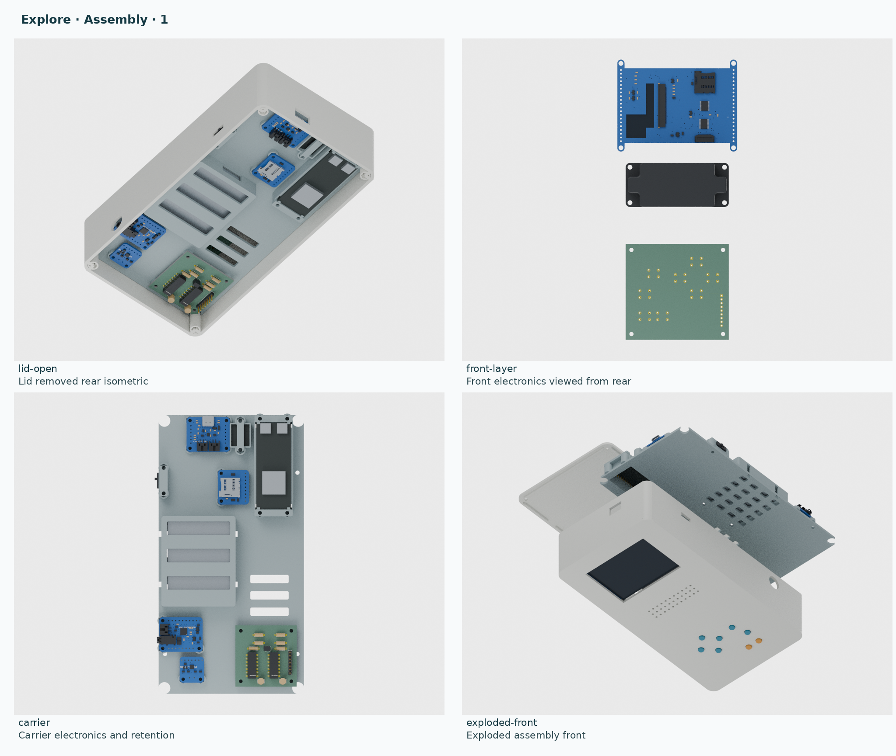

### Assembly 02

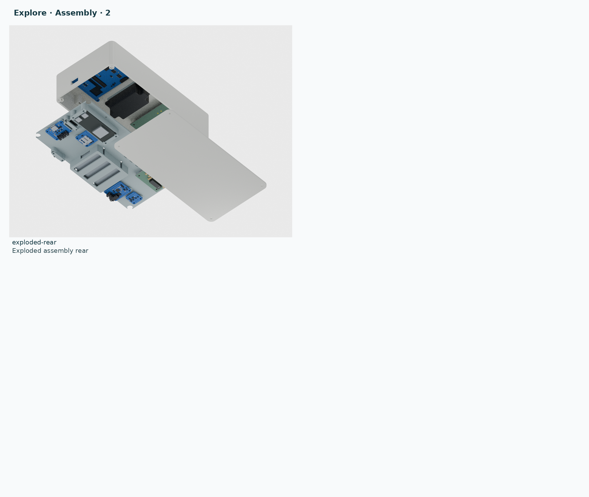

### Sections 01

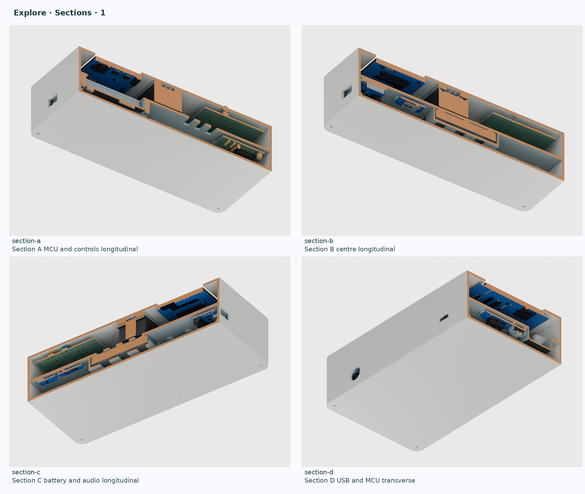

### Sections 02

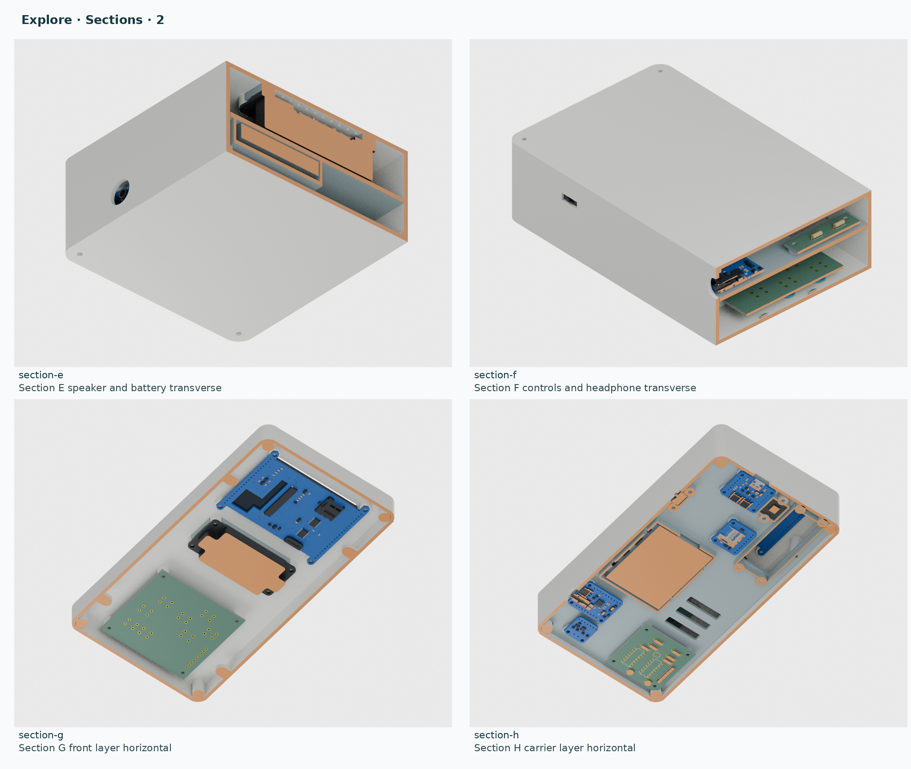

### Details 01

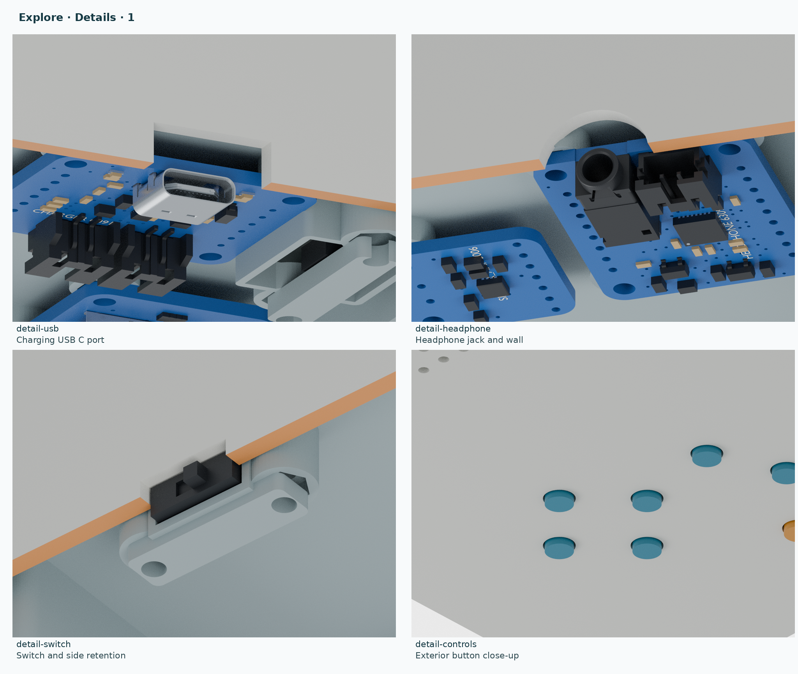

### Details 02

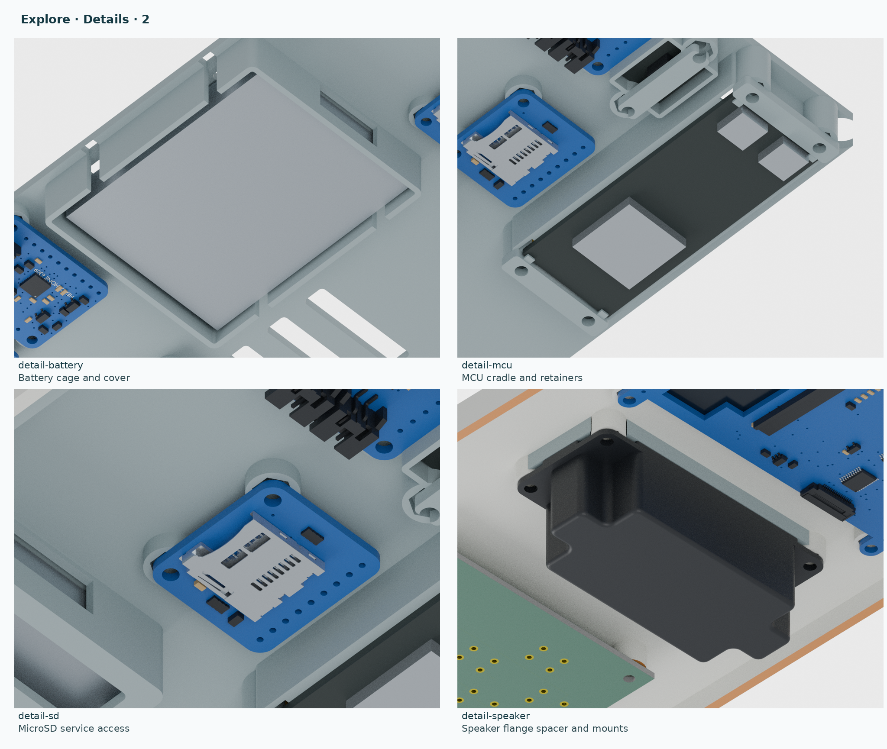

### Boards 01

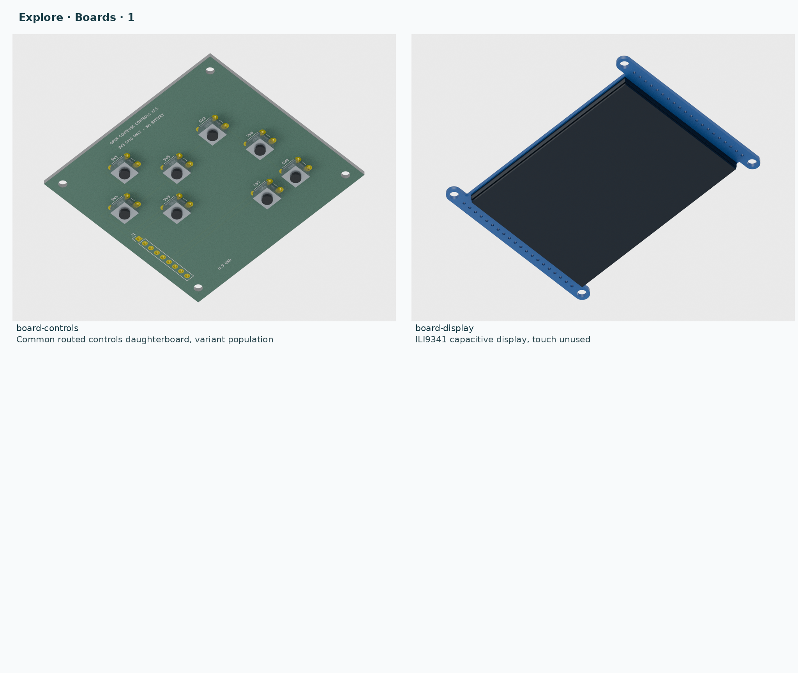

### Full resolution figure index

| View | Description | Interpretation |
| --- | --- | --- |
| [hero-front](images/explore-hero-front.png) | Assembled front isometric | Full nominal assembly. Display is unpowered; case and button colours are proposed finishes. |
| [hero-rear](images/explore-hero-rear.png) | Assembled rear isometric | Full nominal assembly. Display is unpowered; case and button colours are proposed finishes. |
| [orthographic-front](images/explore-orthographic-front.png) | Front orthographic | Full nominal assembly. Display is unpowered; case and button colours are proposed finishes. |
| [orthographic-rear](images/explore-orthographic-rear.png) | Rear orthographic | Full nominal assembly. Display is unpowered; case and button colours are proposed finishes. |
| [orthographic-left](images/explore-orthographic-left.png) | Left orthographic | Full nominal assembly. Display is unpowered; case and button colours are proposed finishes. |
| [orthographic-right](images/explore-orthographic-right.png) | Right orthographic | Full nominal assembly. Display is unpowered; case and button colours are proposed finishes. |
| [orthographic-top](images/explore-orthographic-top.png) | Top orthographic | Full nominal assembly. Display is unpowered; case and button colours are proposed finishes. |
| [orthographic-bottom](images/explore-orthographic-bottom.png) | Bottom orthographic | Full nominal assembly. Display is unpowered; case and button colours are proposed finishes. |
| [lid-open](images/explore-lid-open.png) | Lid removed rear isometric | Lid hidden; front shell and removable carrier remain assembled. Harness and screws omitted. |
| [front-layer](images/explore-front-layer.png) | Front electronics viewed from rear | Case and rear carrier hidden; view faces the rear of the controls PCB. The controls detail shows the opposite actuator side. |
| [carrier](images/explore-carrier.png) | Carrier electronics and retention | Front shell and front electronics hidden. Rear module placement, battery cover and retainers are visible; MCU/regulator are visual proxies. |
| [exploded-front](images/explore-exploded-front.png) | Exploded assembly front | Display offsets only: rear layer +45 mm X/+60 mm Z; lid −80 mm X/+35 mm Y/+120 mm Z. These are not removal paths or measured clearances. |
| [exploded-rear](images/explore-exploded-rear.png) | Exploded assembly rear | Display offsets only: rear layer +45 mm X/+60 mm Z; lid −80 mm X/+35 mm Y/+120 mm Z. These are not removal paths or measured clearances. |
| [section-a](images/explore-section-a.png) | Section A MCU and controls longitudinal | Plane X = 32 mm; retain higher coordinates. Orange marks solid cut faces; voids stay open. Native copper/silk surfaces are clipped without solid caps. Generic/proxy components remain illustrative; supplied module solids do not resolve hidden internal construction. |
| [section-b](images/explore-section-b.png) | Section B centre longitudinal | Plane X = 56 mm; retain higher coordinates. Orange marks solid cut faces; voids stay open. Native copper/silk surfaces are clipped without solid caps. Generic/proxy components remain illustrative; supplied module solids do not resolve hidden internal construction. |
| [section-c](images/explore-section-c.png) | Section C battery and audio longitudinal | Plane X = 82 mm; retain lower coordinates. Orange marks solid cut faces; voids stay open. Native copper/silk surfaces are clipped without solid caps. Generic/proxy components remain illustrative; supplied module solids do not resolve hidden internal construction. |
| [section-d](images/explore-section-d.png) | Section D USB and MCU transverse | Plane Y = 20 mm; retain higher coordinates. Orange marks solid cut faces; voids stay open. Native copper/silk surfaces are clipped without solid caps. Generic/proxy components remain illustrative; supplied module solids do not resolve hidden internal construction. |
| [section-e](images/explore-section-e.png) | Section E speaker and battery transverse | Plane Y = 95 mm; retain higher coordinates. Orange marks solid cut faces; voids stay open. Native copper/silk surfaces are clipped without solid caps. Generic/proxy components remain illustrative; supplied module solids do not resolve hidden internal construction. |
| [section-f](images/explore-section-f.png) | Section F controls and headphone transverse | Plane Y = 168 mm; retain lower coordinates. Orange marks solid cut faces; voids stay open. Native copper/silk surfaces are clipped without solid caps. Generic/proxy components remain illustrative; supplied module solids do not resolve hidden internal construction. |
| [section-g](images/explore-section-g.png) | Section G front layer horizontal | Plane Z = 15 mm; retain lower coordinates. Orange marks solid cut faces; voids stay open. Native copper/silk surfaces are clipped without solid caps. Generic/proxy components remain illustrative; supplied module solids do not resolve hidden internal construction. |
| [section-h](images/explore-section-h.png) | Section H carrier layer horizontal | Plane Z = 35 mm; retain lower coordinates. Orange marks solid cut faces; voids stay open. Native copper/silk surfaces are clipped without solid caps. Generic/proxy components remain illustrative; supplied module solids do not resolve hidden internal construction. |
| [detail-usb](images/explore-detail-usb.png) | Charging USB C port | Charge-only USB C opening. Upper housing is cut away at Z35 to reveal the socket; service USB power isolation is still required. |
| [detail-headphone](images/explore-detail-headphone.png) | Headphone jack and wall | Jack mouth and recess. Upper housing cut away at Z35; plug-barrel fit and insertion-mute validation pending. |
| [detail-switch](images/explore-detail-switch.png) | Switch and side retention | Conservative switch body envelope and retainer. Upper housing cut away at Z35. Actuator dimensions still require received-part measurement. |
| [detail-controls](images/explore-detail-controls.png) | Exterior button close-up | Exterior button caps against the opaque front face; the internal switch stack is not visible here. See section A and the controls PCB view for the internal parts. The documented nominal cap-to-switch gap is 0.2 mm. |
| [detail-battery](images/explore-detail-battery.png) | Battery cage and cover | Battery cover hidden. Rigid cage carries tie tension; do not compress the pouch cell. Cell is shown by manufacturer body geometry; tie/wire routing omitted. |
| [detail-mcu](images/explore-detail-mcu.png) | MCU cradle and retainers | Cradle, edge seats and retaining fingers. MCU geometry is illustrative; assembled/header height remains a fit gate. |
| [detail-sd](images/explore-detail-sd.png) | MicroSD service access | Rotated microSD breakout and removal region. Card extraction is toward +X; reserve the layout corridor and keep the harness out. No removable card is inserted in this render. |
| [detail-speaker](images/explore-detail-speaker.png) | Speaker flange spacer and mounts | Rear layer hidden; housing removed above Z8 to expose flange supports and spacer. Local flange bearing Z 1.0–2.7 mm; post top global Z 7.4 mm; rigid spacer 4 mm. No acoustic seal validated. |
| [board-controls](images/explore-board-controls.png) | Common routed controls daughterboard, variant population | Open Conteuse CONTROLS-V0.1. Native KiCad board with generic component bodies; green soldermask is proposed. |
| [board-display](images/explore-board-display.png) | ILI9341 capacitive display, touch unused | Adafruit 2090. Manufacturer CAD geometry with illustrative finish and component material assignment. |

## BOM and assembly

[Every exact purchased part and supplier query](../../hardware/integration/BOM.csv) · [Printed parts and quantities](../../enclosure/integrated/print/assembly_BOM.csv) · [Electrical and mechanical assembly](../../hardware/integration/README.md) · [Budget](../HARDWARE_COST.md)

## Regenerate

```sh
python3 scripts/prepare_atlas.py
python3 scripts/run_atlas.py
python3 scripts/build_atlas_doc.py
python3 scripts/check_atlas.py
```

CadQuery 2.7 prepares manufacturer solids; KiCad 9 exports exact board/copper/silk geometry; Blender 4.3.2/Cycles CPU renders with 24 samples and seed 31415. Camera fitting is orthographic. Section clipping does not edit any printable STL or KiCad source. Rigid KiCad frame mappings preserve board handedness, and an independent regression check verifies the hollow section and all eight actuator centres. Manufacturer Adafruit meshes retain their existingMIT attribution; native KiCad library-derived geometry retains the existing KiCad library exception notices.

The manifest binds source hashes and rendered files. Wires/fasteners, received-part dimensions and every physical validation gate remain outside the rendered proof.
